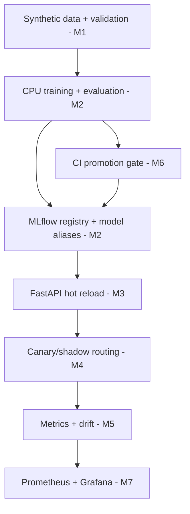

# ml-platform-starter

A CPU-first, single-node **MLOps reference platform** being built milestone-by-milestone to demonstrate reproducible training, governance, safe serving, and drift monitoring. The model is deliberately simple; the platform is the product.

[](https://github.com/DanyVX/ml-platform-starter/actions/workflows/ci.yml)

**Demo:** TBD (not yet implemented). M0 currently has an environment-diagnostics CLI.

## Key results

| Evidence | Result | Reproduction |
|---|---|---|
| PR-AUC / ECE / worst slice | TBD (not yet measured) | M2 training + `eval/` |
| Serving p50 / p95 latency | TBD (not yet measured) | M3 load benchmark |
| PSI / KS drift detection | TBD (not yet measured) | M5 drift injection harness |
| Drift false-alarm rate | TBD (not yet measured) | M5 drift injection harness |
| Canary rollback demonstration | TBD (not yet implemented) | M4 demo |
| Promotion accept / reject | TBD (not yet implemented) | M6 promotion gate |

No measured values are claimed until scripts produce committed JSON results with hardware and commit metadata.

## Why this exists

The purpose is to show platform engineering rather than a notebook. The eventual system will train and register a deliberately small model, load it by MLflow registry alias, route challenger traffic safely, detect shift in production inputs and scores, and promote only models that pass measured regression gates.

**M0 is a scaffold, not a functioning ML platform.** Later milestones are planned, not completed.

## Architecture



## Quickstart (M0)

Requires Python 3.11 or 3.12 and network access for the initial dependency installation. Clone the repo, then:

```bash
python -m pip install -e ".[dev]"
python -m mlp doctor --json
python -m mlp config
python -m pytest
```

If uv is installed, `uv sync --extra dev` creates a local environment. Use `uv run mlp doctor --json` afterward. A committed transitive lockfile is pending until dependency resolution can run in a networked environment.

On Linux/macOS where make exists, `make lint`, `make typecheck`, and `make test` run the M0 gates. On Windows, use `python scripts/tasks.py <task>` instead. Tasks that do not exist yet (`bench`, `docker-build`) fail explicitly rather than pretending to succeed.

## Usage examples

```bash
python -m mlp doctor
MLP_TINY_ROWS=128 python -m mlp config
```

The CLI reports probe status without printing a configured git identity, environment variable values, or credentials. In current M0, model inference, MLflow registration, and `make up` are not implemented.

## Configuration

All current settings are defined in `src/mlp/common/config.py`; see `.env.example`. Invalid values fail fast. Configure JSON logging with `MLP_LOG_JSON=true`. Do not place real biometric/ID data, API keys, or model artifacts in this repository.

## Reproducing benchmarks

There are no M0 model or system benchmark results. Starting in M2, every result must originate from a documented script, include software/hardware/commit metadata, and be saved under `results/*.json`. See [RESULTS](docs/RESULTS.md).

## Design decisions

See the dated [decision log](docs/DESIGN.md) for the synthetic pilot dataset, single-node scope, MLflow alias strategy, platform boundaries, and rejected alternatives.

## Limitations

The pilot dataset is synthetic and **cannot support claims about real-world predictive value or fairness**. This build does not yet train, register, serve, monitor, deploy, or authenticate models. See [LIMITATIONS](docs/LIMITATIONS.md), [DATA](DATA.md), and [MODEL CARD](MODEL_CARD.md).

## Roadmap

M0 (setup) → M1 (validated data) → M2 (training + registry) → M3 (serving + reload) → M4 (canary/shadow) → M5 (drift monitoring) → M6 (promotion CI) → M7 (Compose demo) → M8 (release and evidence). Each milestone gets its own reviewed PR.

## License

MIT. See [LICENSE](LICENSE). Dependency and model terms are tracked before incorporation.

## Acknowledgements and citations

Planned components: scikit-learn, MLflow, FastAPI, Prometheus, Grafana. Their licenses and API contracts must be verified at the milestone where each becomes a dependency. No external dataset or pretrained model is included in M0.
