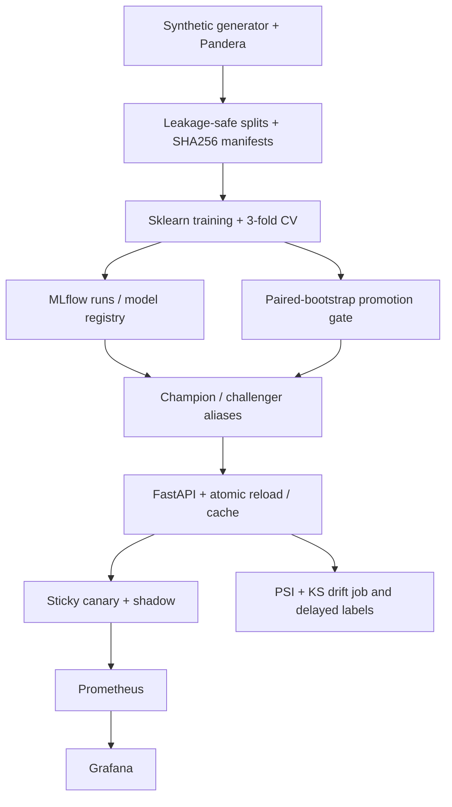

# ML Platform Starter

**Single-node MLOps reference platform:** deterministic synthetic data → MLflow model registry → FastAPI model serving → sticky canary/shadow routing → Prometheus/Grafana → drift detection → statistical promotion gate.

[](https://github.com/DanyVX/ml-platform-starter/actions/workflows/ci.yml)

**Status:** engineering reference implementation, not production-ready. No real customer dataset or biometric material. No model result or latency claim without a generated evidence file.

## Demo

Reproduce locally with Docker Compose. An animated GIF has not been captured yet.

## Key results

| Measurement | Result | How to reproduce |
|---|---|---|
| Synthetic classifier PR-AUC, calibration and worst-slice | TBD (not yet measured and committed) | `python -m mlp train`, inspect MLflow artifacts |
| Serving p95 latency | TBD (not yet measured and committed) | `make demo`, Prometheus histogram |
| Drift detection and false alarm rate | TBD (not yet measured and committed) | `python eval/drift_injection.py` |
| Paired bootstrap promote accept/reject | Demonstrated with deterministic unit fixtures, not live model win | `python -m pytest tests/test_promotion.py` |
| Hot reload under concurrency | TBD (not yet benchmarked) | Integration race harness planned |

## Why this exists

A realistic portfolio project about the *lifecycle and safe operations of models*. Logistic regression is intentionally modest. The interesting questions are: which data produced a model, when should it be promoted, can serving fail safely, and is drift detection evidence-based rather than decorative?

## Architecture



## Quickstart

Python 3.11 or 3.12, Docker Desktop or Docker Engine with Docker Compose v2, and enough disk space for image pulls are required. **Never expose the ports publicly.**

```bash
git clone https://github.com/DanyVX/ml-platform-starter.git
cd ml-platform-starter
python -m pip install -e ".[dev]"
python -m pytest
make demo
```

On Windows, replace Make targets with `python scripts/tasks.py <task>`. For a Compose-only run:

```bash
docker compose -f deploy/docker-compose.yml up -d --build
docker compose -f deploy/docker-compose.yml exec -T api python -m mlp train
```

Local services:

| Service | Address | Purpose |
|---|---|---|
| API | http://127.0.0.1:8000/docs | Validated predictions |
| MLflow | http://127.0.0.1:5000 | Experiments and registry |
| Prometheus | http://127.0.0.1:9090 | Bounded route/status metrics |
| Grafana | http://127.0.0.1:3000 | Provisioned dashboard |

Grafana's demo admin credentials must be changed outside a local trusted environment.

## Usage examples

```bash
python -m mlp doctor --json
python -m mlp data-build --rows 200 --output-dir data/synthetic
python -m mlp data-verify --data-dir data/synthetic
python -m mlp train
python eval/drift_injection.py
python scripts/promote.py
python scripts/reproduce.py 1
```

After a champion is registered and service readiness is healthy:

```bash
curl -X POST http://127.0.0.1:8000/v1/predict \
  -H "Content-Type: application/json" \
  -d '{"records":{"f_0":0.1,"f_1":0.1,"f_2":0.1,"f_3":0.1,"f_4":0.1,"f_5":0.1,"channel":"web"}}'
```

## Configuration

See `.env.example`. Important variables: `MLP_TRACKING_URI`, `MLP_CACHE_DIR`, `MLP_RELOAD_INTERVAL`, `MLP_CANARY_PERCENT`, `MLP_SHADOW_MODE` and timeout/seed settings. Unknown train/serve channels are rejected, rather than silently mapped. Batch limit: 128 records.

## Reproducing benchmarks

`python eval/drift_injection.py` generates `results/drift_injection.json` with measured detector rates, repeat count, seed, commit, Python/library versions and machine information. Model metrics are logged to MLflow with a data manifest. No numbers are to be copied from papers or invented; when a result file is absent we say TBD.

## Design decisions

See [DESIGN](docs/DESIGN.md): synthetic data avoids external consent/license risk, MLflow aliases permit controlled promotion/rollback, hand-coded PSI/KS is inspectable, and a paired bootstrap prevents promoting noise.

## Limitations

Single-node only, no network authentication by default, internal cache uses trusted pickle/joblib, not a public hosting template. Caching validates SHA-256 but does not cryptographically authenticate an attacker-controlled cache. Forecasting fairness from synthetic categories would be meaningless. MLflow registry is local/ephemeral in the hosted promotion workflow. See [LIMITATIONS](docs/LIMITATIONS.md).

## Roadmap

- [x] M0: engineering scaffold
- [x] M1: deterministic validated data
- [ ] M2: MLflow training and measured calibration artifacts
- [ ] M3: registry serving, race testing and safe cache
- [ ] M4: canary/shadow and rollback
- [ ] M5: drift and delayed-label monitoring
- [ ] M6: promotion gate and documented accept/reject
- [ ] M7: one-command Compose and monitoring
- [ ] M8: full end-to-end verified release with v0.1.0 and demo GIF

Items M2-M8 must only be checked after their merged PR and CI evidence confirms acceptance.

## License

**License notice: Grafana OSS is AGPL-3.0-only** and runs as a separate, unmodified Docker image in the optional observability stack. The project source remains MIT; integrating or modifying/distributing Grafana has separate obligations. See the upstream Grafana LICENSING.md before distribution. MLflow uses Apache-2.0, Pandera MIT.

MIT for project source. See [LICENSE](LICENSE), [DATA](DATA.md), and [MODEL_CARD](MODEL_CARD.md). Upstream licenses must be reviewed and updated for each dependency.

## Acknowledgements

MLflow, scikit-learn, Pandera, FastAPI, Prometheus and Grafana open-source maintainers.
